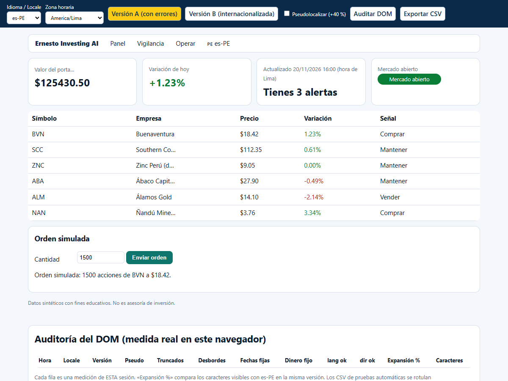
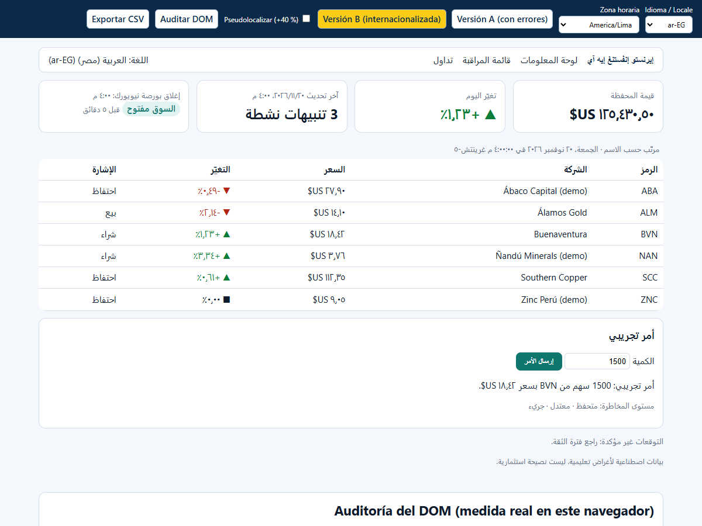
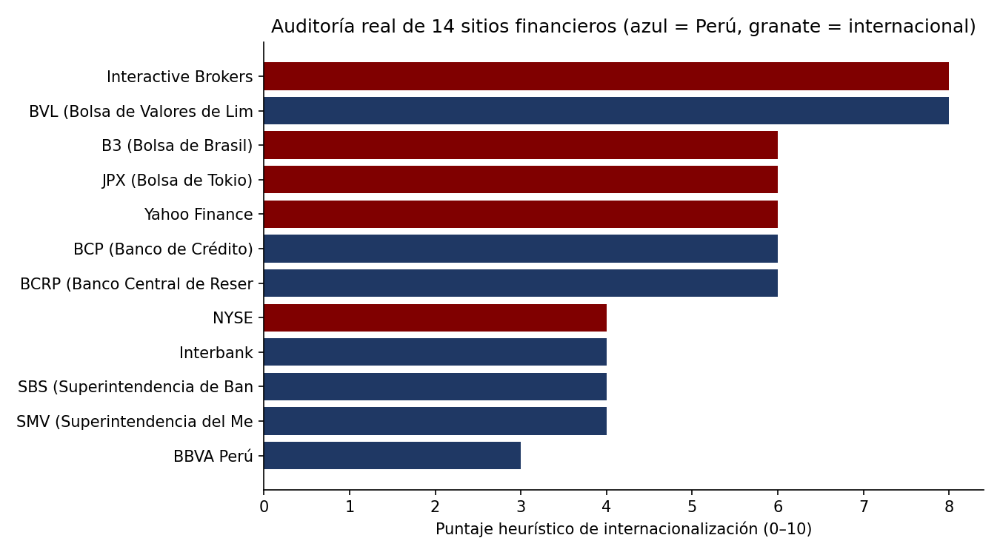
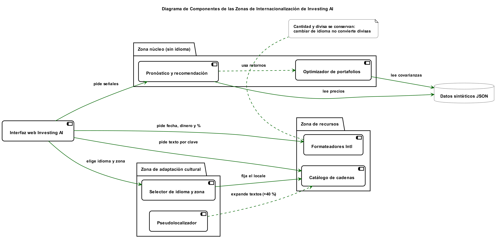
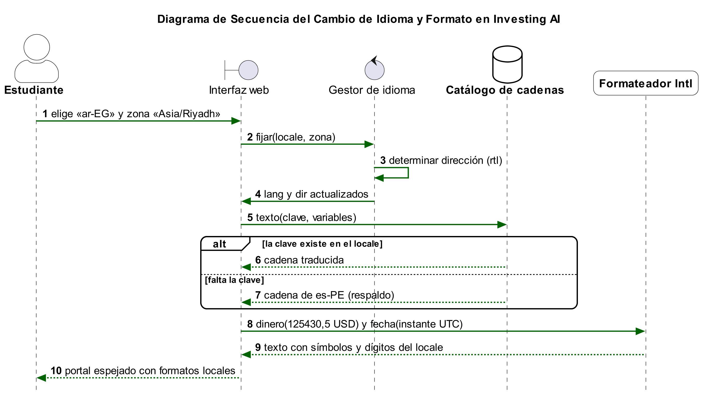
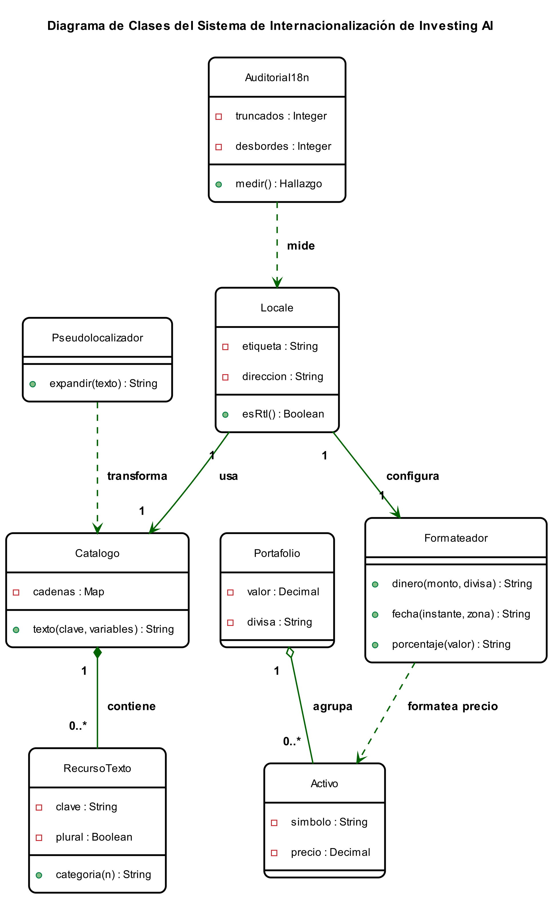
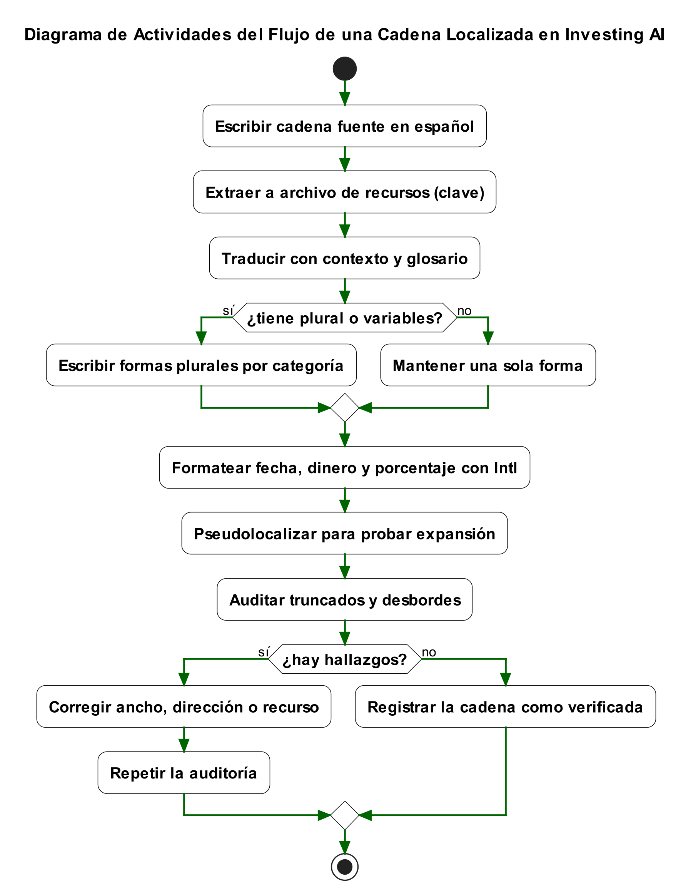
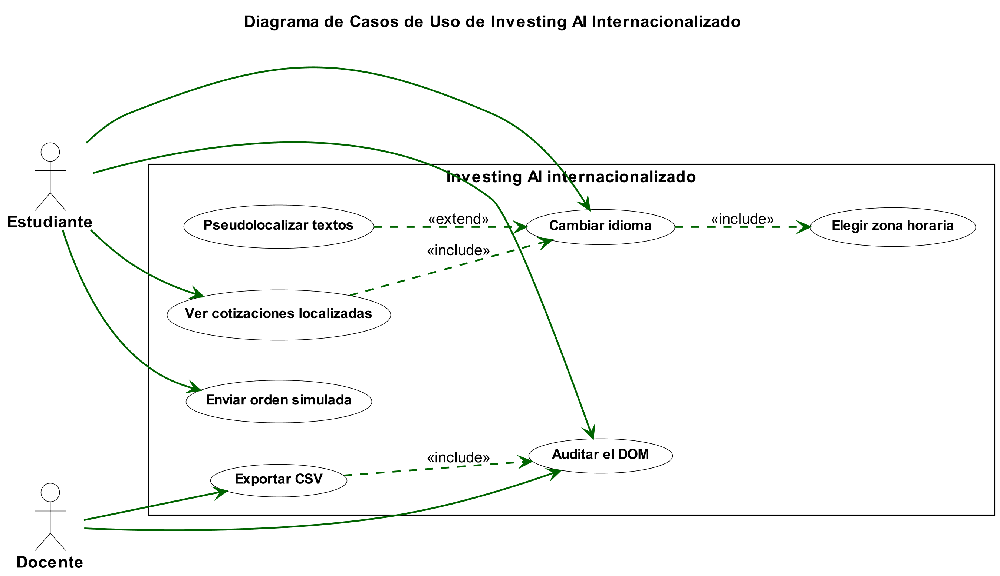

# Internacionalización y localización de interfaces (i18n / l10n) — Laboratorio 13 (IHC)

[](LICENSE)
[](https://mbaernestocr-tech.github.io/ihc-internacionalizacion-i18n-lab13/)
[](scripts/test_s13.py)
[-5B2C6F.svg)](investing-i18n-kit/)

**ES** · Material práctico del Laboratorio del Tema 13 (Internacionalización y localización de interfaces) del curso de Interacción Hombre-Computador. Incluye tres aplicaciones HTML + JavaScript (inspector de codificaciones, portal «Investing AI» en versión A con errores y B internacionalizada, experimento de formatos), un **kit de i18n** listo para integrarse en un sitio propio, un notebook que analiza una **auditoría real de 14 sitios financieros**, cinco diagramas UML y ocho prompts XML en estilo **ESLBHP**.

**EN** · Hands-on material for Lab 13 (Internationalization and localization of interfaces) of the Human-Computer Interaction course: three HTML + JavaScript tools (encoding inspector, "Investing AI" portal with a flawed version A and an internationalized version B, formats experiment), a drop-in **i18n kit**, a notebook that analyses a **real audit of 14 finance websites**, five UML diagrams and eight XML prompts in **ESLBHP** style.

Elaborado para el curso de IHC (202W0606) de la FISI-UNMSM (semestre 2026-II, Semana 13, Unidad IV) por Ernesto D. Cancho-Rodríguez. Continúa el [Laboratorio 12 (accesibilidad)](https://github.com/mbaernestocr-tech/ihc-accesibilidad-wcag-lab12) y usa como caso común el [sistema base «Ernesto Investing AI»](https://github.com/mbaernestocr-tech/ernesto-investing-ai-base-s13).

## Pruébelo en línea (GitHub Pages)

**[Portada](https://mbaernestocr-tech.github.io/ihc-internacionalizacion-i18n-lab13/)** ·
[13.1 Codificaciones](https://mbaernestocr-tech.github.io/ihc-internacionalizacion-i18n-lab13/html/ejercicio_13_1_laboratorio_codificaciones.html) ·
[13.2 Portal A frente a B](https://mbaernestocr-tech.github.io/ihc-internacionalizacion-i18n-lab13/html/ejercicio_13_2_portal_i18n_A_vs_B.html) ·
[13.3 Experimento de formatos](https://mbaernestocr-tech.github.io/ihc-internacionalizacion-i18n-lab13/html/ejercicio_13_3_experimento_formatos_locales.html)

| Versión A (con 12 errores clásicos), es-PE | Versión B (internacionalizada), ar-EG (RTL) |
|---|---|
|  |  |

## Contenido

| Carpeta | Qué contiene |
|---|---|
| [`html/`](html/) | Ejercicios 13.1 a 13.3: archivos únicos, sin instalación (el kit va incluido dentro de cada página) |
| [`investing-i18n-kit/`](investing-i18n-kit/) | `i18n.js` + cadenas en 5 idiomas: lo que los equipos integran en su proyecto |
| [`notebooks/`](notebooks/) | Notebook del ejercicio 13.3 (ejecutado) y su versión `.py` |
| [`datos/`](datos/) | Auditoría **real** de 14 sitios y datos **simulados** de prueba técnica (rotulados) |
| [`diagramas/`](diagramas/) | Cinco diagramas UML en PlantUML (`.puml`) e imagen (`.png`), con cuerpos blancos imprimibles |
| [`prompts-eslbhp/`](prompts-eslbhp/) | Ocho prompts XML y el archivo maestro |
| [`figuras/`](figuras/), [`capturas/`](capturas/) | Figuras del notebook y capturas de los ejercicios |
| [`scripts/`](scripts/) | Auditoría de sitios y pruebas automáticas en Chrome (Playwright) |

## Ejercicios HTML (`html/`)

Se abren con doble clic en cualquier navegador moderno (usan `Intl`, `TextEncoder`, `Intl.Segmenter`).

| Archivo | Qué hace |
|---|---|
| `ejercicio_13_1_laboratorio_codificaciones.html` | Puntos de código, bytes en UTF-8/UTF-16/Latin-1, grafemas, generador de **mojibake** (codificar en X y decodificar en Y), normalización NFC/NFD, registro y CSV |
| `ejercicio_13_2_portal_i18n_A_vs_B.html` | Portal de Investing AI en es-PE, en-US, qu-PE (borrador), ar-EG y ja-JP. Versión **A** con 12 errores clásicos y versión **B** correcta (`Intl`, plurales, `dir`, CSS lógico); pseudolocalización; **auditor del DOM** que cuenta truncados y desbordes; exporta CSV |
| `ejercicio_13_3_experimento_formatos_locales.html` | Experimento intra-sujetos: 8 datos financieros en formato ambiguo (A) y 8 en explícito (B), con orden contrabalanceado, tiempo y confianza; CSV por participante (código anónimo y consentimiento) |

### Resultados de la prueba técnica del portal (datos simulados, no son personas)

| Locale | Truncados A | Truncados B | Desbordes A | Desbordes B |
|---|---|---|---|---|
| `ar-EG` | 4.0 | 0.0 | 0.0 | 0.0 |
| `en-US` | 4.0 | 0.0 | 0.0 | 0.0 |
| `es-PE` | 5.0 | 0.0 | 0.0 | 0.0 |
| `ja-JP` | 5.0 | 0.0 | 0.0 | 0.0 |
| `qu-PE` | 5.0 | 0.0 | 0.0 | 0.0 |

La versión A trunca por su ancho fijo de 96 px y no espeja el árabe; la B no trunca ni desborda, incluso a 375 px de ancho. Cada pulsación de «Auditar DOM» agrega una fila.

## Kit de internacionalización (`investing-i18n-kit/`)

```html
<script src="investing-i18n-kit/i18n.js"></script>
<script>
  const L = ['es-PE','en-US','ar-EG','ja-JP','qu-PE'];
  Promise.all(L.map(l => fetch('investing-i18n-kit/locales/'+l+'.json').then(r => r.json())))
    .then(a => { I18N.load(Object.fromEntries(L.map((l,i)=>[l,a[i]])));
                 I18N.set({locale:'ar-EG', tz:'America/Lima'}); I18N.apply(); });
</script>
<h1 data-i18n="brand"></h1>
```

`I18N.t()` (con plurales por categoría CLDR y respaldo a es-PE), `money`, `dt`, `pct`, `rel`, `sort` (`Intl.Collator`), `dir()` y `pseudoloc()`. **La cantidad y la divisa se conservan al cambiar de idioma: nunca se convierten divisas.** Sirva el sitio con `python -m http.server` (los navegadores bloquean `fetch()` con doble clic).

## Auditoría real de 14 sitios financieros (`datos/auditoria_i18n_sitios_reales.csv`)

Fuente B: se midió la **página de inicio** de cada sitio con Chrome (Playwright) el 20-nov-2026. **12 sitios válidos de 14**; Investing.com y Saudi Exchange bloquearon el acceso (HTTP 403) y **no se promedian**. Puntaje heurístico 0–10 (`lang` 2, charset 1, `hreflang` 2, selector de idioma 2, respuesta a `Accept-Language` 2, sin banderas como idioma 1): promedio **5.0** para Perú y **6.0** para sitios internacionales. Ningún sitio válido cambió de idioma al enviar `Accept-Language: ja-JP` en la portada.

| Sitio | País | `lang` | `hreflang` | Selector | Responde a `Accept-Language` | Puntaje (0–10) |
|---|---|---|---|---|---|---|
| B3 (Bolsa de Brasil) | INT | pt-BR | 3 | no detectado | no | 6 |
| Interactive Brokers | INT | en | 4 | sí | no | 8 |
| Investing.com | INT | — | — | — | — | NO VÁLIDA (HTTP 403) |
| JPX (Bolsa de Tokio) | INT | ja | 0 | sí | no | 6 |
| NYSE | INT | en | 0 | no detectado | no | 4 |
| Saudi Exchange (Tadawul) | INT | — | — | — | — | NO VÁLIDA (HTTP 403) |
| Yahoo Finance | INT | en-US | 8 | no detectado | no | 6 |
| BBVA Perú | PE | es-PE | 0 | no detectado | no | 3 |
| BCP (Banco de Crédito) | PE | es | 0 | sí | no | 6 |
| BCRP (Banco Central de Reserva) | PE | es-es | 0 | sí | no | 6 |
| BVL (Bolsa de Valores de Lima) | PE | es | 2 | sí | no | 8 |
| Interbank | PE | es-PE | 0 | no detectado | no | 4 |
| SBS (Superintendencia de Banca) | PE | es-ES | 0 | no detectado | no | 4 |
| SMV (Superintendencia del Mercado de Valores) | PE | es-pe | 0 | no detectado | no | 4 |



> Es una medición de portadas, de un solo día y con una heurística: **no es un veredicto sobre cada sitio**. Las capturas de los sitios auditados no se incluyen.

## Notebooks (`notebooks/`)

| Archivo | Descripción |
|---|---|
| `ejercicio_13_3_analisis_internacionalizacion.ipynb` | Codificaciones en Python (`encode`, `decode`, `unicodedata`), puntaje i18n por sitio (Perú frente a internacional), truncados A frente a B, aciertos del experimento con intervalo de Wald ajustado (Agresti–Coull). Se entrega ejecutado; si falta un CSV, avisa y continúa sin inventar datos |
| `ejercicio_13_3_analisis_internacionalizacion.py` | Las mismas celdas concatenadas |

El notebook busca los CSV en `datos/` y `datos/simulados/`. **Los CSV de `datos/simulados/` los generó un robot para probar el flujo (`*_PRUEBA_TECNICA_BOT.csv`): no son datos de personas y no se interpretan.** Para conclusiones use los CSV exportados por su grupo.

## Diagramas UML (`diagramas/`)

Cuerpos blancos (imprimibles), diferencia por estereotipos y forma, no por color.

| Diagrama | Imagen | Código |
|---|---|---|
| Componentes (zonas de internacionalización) | [PNG](diagramas/S13_UML_componentes.png) | [`.puml`](diagramas/S13_UML_componentes.puml) |
| Secuencia (cambio de idioma y formato) | [PNG](diagramas/S13_UML_secuencia.png) | [`.puml`](diagramas/S13_UML_secuencia.puml) |
| Clases | [PNG](diagramas/S13_UML_clases.png) | [`.puml`](diagramas/S13_UML_clases.puml) |
| Actividades (flujo de una cadena localizada) | [PNG](diagramas/S13_UML_actividades.png) | [`.puml`](diagramas/S13_UML_actividades.puml) |
| Casos de uso | [PNG](diagramas/S13_UML_casos_uso.png) | [`.puml`](diagramas/S13_UML_casos_uso.puml) |











Regenerar las imágenes: `plantuml -tpng diagramas/*.puml`.

## Prompts XML (`prompts-eslbhp/`)

**ESLBHP** (*Ernesto Style Label-Based Hyperdetailed Prompts*): cada prompt es un bloque XML con etiquetas fijas (`<role>`, `<context>`, `<task>`, `<constraints>`, `<output>`, `<verification>`). Regla ética común: la IA genera **borradores**; una traducción no está validada hasta que la revise una persona hablante competente.

| ID | Prompt |
|---|---|
| P01 | Auditar la internacionalización de una interfaz |
| P02 | Extraer cadenas a archivos de recursos (JSON con variables y plurales) |
| P03 | Traducir con contexto y glosario controlado |
| P04 | Adaptación cultural de la interfaz (dimensiones culturales como hipótesis) |
| P05 | Revisar plurales, género y orden con reglas CLDR |
| P06 | Pseudolocalizar y probar la expansión de texto |
| P07 | Plan de pruebas de localización con personas |
| P08 | Guía técnica de internacionalización del proyecto |

El archivo `ESLBHP_Semana13_Internacionalizacion_maestro.xml` reúne los ocho.

## Cómo ejecutarlo

```bash
git clone https://github.com/mbaernestocr-tech/ihc-internacionalizacion-i18n-lab13.git
cd ihc-internacionalizacion-i18n-lab13

# 1) Ejercicios HTML: abra html/*.html con doble clic, o sirva el repositorio:
python -m http.server 8000          # http://127.0.0.1:8000

# 2) Notebook
python -m venv .venv && source .venv/bin/activate      # en Windows: .venv\Scripts\activate
pip install -r requirements.txt
cd notebooks && jupyter lab

# 3) (opcional) Pruebas automáticas en Chrome
pip install playwright && set CHROME_PATH="ruta\a\chrome.exe"
python scripts/test_s13.py
```

En Google Colab: abra el notebook y suba los CSV de `datos/` cuando lo pida la primera celda.

## Alcance y advertencias

- Material **educativo**. Los precios y portafolios de Investing AI son **sintéticos** y no constituyen asesoría de inversión.
- Las traducciones a árabe, japonés y quechua son **borradores generados con IA** que requieren revisión de personas hablantes competentes; no se han validado con ellas.
- No se han hecho pruebas con participantes humanos; los CSV simulados son de robot.
- Las cifras de expansión de texto (+20 % a +35 %) son orientativas.
- Parte del código y de los textos se elaboró con asistencia de IA generativa (Claude, de Anthropic); el autor revisó el contenido y responde por él.

## Licencia y cita

© 2026 Ernesto D. Cancho-Rodríguez. Notebooks, código, datos sintéticos, diagramas y textos bajo [Creative Commons Atribución 4.0 Internacional (CC BY 4.0)](https://creativecommons.org/licenses/by/4.0/); el texto legal está en [`LICENSE`](LICENSE). Para citar: [`CITATION.cff`](CITATION.cff).
